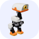
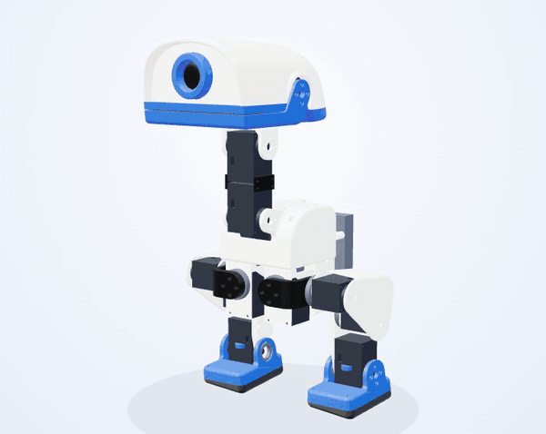
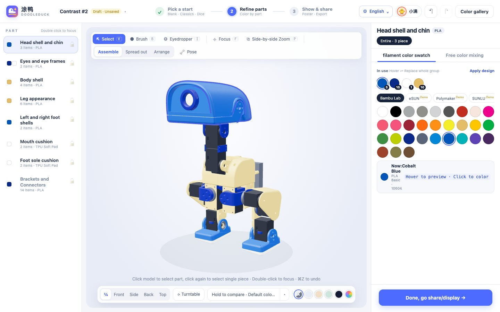
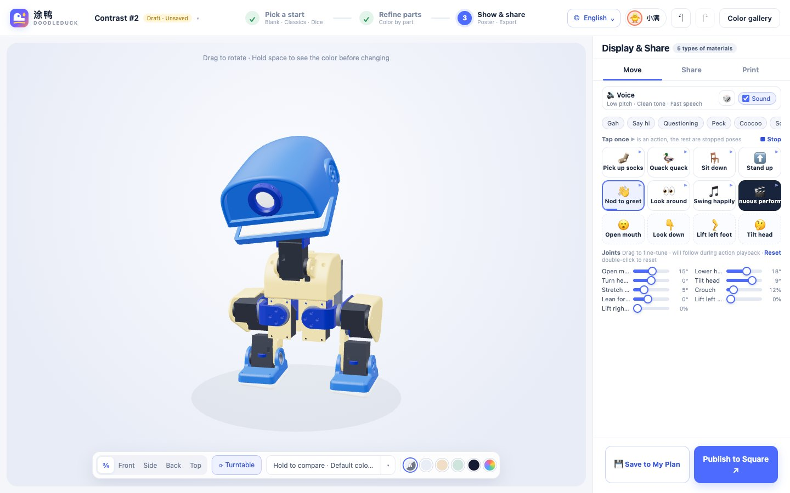

<p align="right"><a href="README.md">简体中文</a> · <b>English</b></p>

# letsduck · 来做鸭

<p align="center"></p>

A painting tool for the XGO Duck V2. Choose colours, make posters, and export a recoloured 3MF and bill of materials.

> [!IMPORTANT]
> **Debug and Assemble are currently internal test previews. Their functionality is not yet available for use.**
> **Do not follow Assemble's tutorials or use Debug with real hardware.** For actual debugging, use the [manufacturer's official debugging software (downloads)](https://downloads.xgorobot.com/xgoduck/).

**Runs in your local browser: the repository already includes the models and resources it needs. Double-click the launcher; no separate asset pack or 3MF is required.**

<p align="center"></p>

## Current maintenance scope

- **Only the local browser edition is maintained** (Apple silicon Mac): a local service plus browser pages for painting, saved schemes, export, Debug and the simulator. Desktop installers are no longer provided; Windows, Intel Mac and Linux are not maintained.
- **Server maintenance is paused**: server development, adaptation, updates and deployment are on hold. Existing source and documentation remain available. Future local-edition changes do not promise corresponding server support; resuming server maintenance requires a separate explicit decision.

## Local edition

On the home page, drag the three ducks sideways or use the arrow keys. Click a side duck to bring it to the centre, then click the centre duck to open its tool.

| Entry | Features and current status | Usage |
| --- | --- | --- |
| Paint `/paint` | Palettes, part colours, poses, posters, saved schemes, 3MF + BOM export | Required resources are included in the repository |
| Debug `/debug/` | Internal test preview; functionality not yet available for use | Do not use with real hardware; use the manufacturer's official debugging software instead |
| Assemble `/assemble/` | Internal test preview; functionality not yet available for use | Do not follow the assembly tutorials |

Poses and animations in the painting studio are screen previews and do not control real hardware.

### Paint and export

1. **Choose a start:** a blank duck, classic palette, inspiration dice or a saved scheme.
2. **Refine parts:** select a part on the model or in the list, then choose a filament colour or mix your own. Tools include a brush, eyedropper, focus, A/B comparison and part locks.
3. **Show and export:** pose the duck, play moves and sounds, change the background, make a poster, and export a recoloured 3MF and BOM with the print structure preserved.

<table><tr>
<td></td>
<td></td>
</tr></table>

Export targets a fixed project with 35 parts and 6 print plates. Display poses and exploded views do not alter manufacturing meshes. Arbitrary 3MF import, automatic slicing and printer control are outside the project. Screen colours do not guarantee physical colour accuracy, and model previews do not validate assembly tolerances.

The home, paint, debug and assembly interfaces use the existing 12 language dictionaries. See [translation maintenance](docs/i18n.md) for coverage and review status.

### Install and launch

Requires Node.js 24.20+ (24.x). The repository's `assets/` already contains the required resources; see [local assets](docs/local-assets.md).

```sh
git clone https://github.com/1850VV/letsduck.git
cd letsduck
npm ci
npm run start:local
```

Afterwards, double-click `启动来做鸭.command`: it builds the pages, starts the local service and opens the browser. The default URL is `http://127.0.0.1:8876/`; if the port is taken, the next one is tried. During development, `npm run start:local -- --port 8880 --no-open` chooses a port and skips opening the browser. To update, `git pull` and double-click the launcher again.

Named schemes, numbering verification and pick progress are stored in `~/Library/Application Support/DoodleDuck/personal.db`; override the path with `DUCK_PERSONAL_DB`. Drafts, language, servo check results and other preferences are stored in the browser.

## Server edition (maintenance paused)

The existing accounts, private schemes, palette gallery, ratings, remixes and Docker Compose configuration remain in the repository. Server-specific features and deployment are no longer actively maintained. Shared frontend, storage and export code needed by the local edition remains maintained. Passing existing regression checks does not establish ongoing server support. Previous setup, HTTPS, migration and backup instructions are retained as [historical reference](docs/deployment.md).

## Development and documentation

```sh
npm run verify
```

See [development and verification](docs/development.md) for asset, MySQL and browser requirements. Technical checks do not replace human interaction or physical-device acceptance.

- [Project structure](docs/project.md) · [Local assets](docs/local-assets.md) · [Translations](docs/i18n.md)
- [Contributing](CONTRIBUTING.md) · [Security reports](SECURITY.md) · [Publication scope](docs/publication.md)

## Licence

Original code and documentation use [MIT](LICENSE). Three.js, meshoptimizer, MicroDuck and other third-party code retain their respective notices; see [third-party notices](THIRD_PARTY_NOTICES.md). Models, manufacturer data, brands and model imagery in this README receive no new licence through this repository. letsduck is not an official product of Luwu Dynamics, Pollen Robotics, Bambu Lab or DeepSeek.
