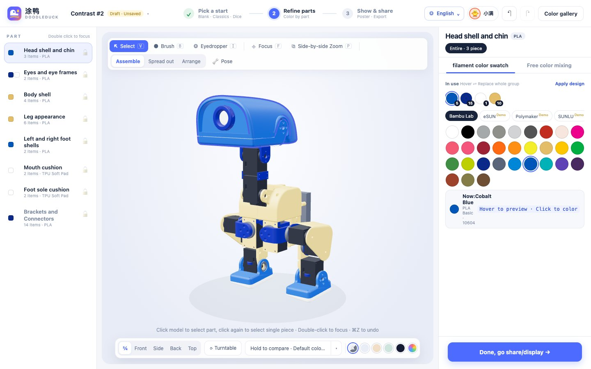
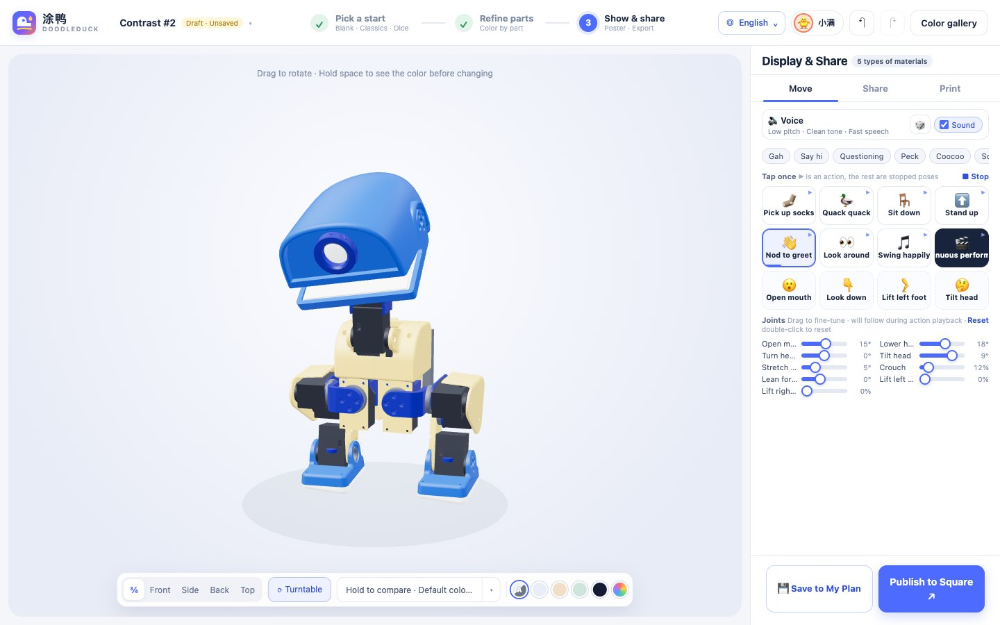

<p align="right"><a href="README.md">简体中文</a> · <b>English</b></p>

# letsduck · 来做鸭

<p align="center"></p>

A painting tool for the XGO Duck V2. Choose colours, make posters, and export a recoloured 3MF and bill of materials.

> [!IMPORTANT]
> **Debug and Assemble are currently internal test previews. Their functionality is not yet available for use.**
> **Do not follow Assemble's tutorials or use Debug with real hardware.** For actual debugging, use the [manufacturer's official debugging software (downloads)](https://downloads.xgorobot.com/xgoduck/).

**Client downloads include the models, resources and runtime needed to run the application. Install the desktop client or extract the browser archive to get started; no separate asset pack or 3MF is required.**

<p align="center"></p>

## Two editions

- **Client edition (primary)**: painting, saved schemes and export on your own computer; Debug and Assemble are internal test previews only. Available only for **Apple silicon Macs (arm64)** and **Windows x64**. No Intel Mac, Linux or other client platforms are provided.
- **Server edition**: self-hosted palette sharing, ratings and remixes. Optimisation and adaptation remain limited; see the brief server section below.

## Client edition

On the client home page, drag the three ducks sideways or use the arrow keys. Click a side duck to bring it to the centre, then click the centre duck to open its tool.

| Entry | Features and current status | Usage |
| --- | --- | --- |
| Paint `/paint` | Palettes, part colours, poses, posters, saved schemes, 3MF + BOM export | Required resources are included in the client |
| Debug `/debug/` | Internal test preview; functionality not yet available for use | Do not use with real hardware; use the manufacturer's official debugging software instead |
| Assemble `/assemble/` | Internal test preview; functionality not yet available for use | Do not follow the assembly tutorials |

Poses and animations in the painting studio are screen previews and do not control real hardware.

### Paint and export

1. **Choose a start:** a blank duck, classic palette, inspiration dice or a saved scheme.
2. **Refine parts:** select a part on the model or in the list, then choose a filament colour or mix your own. Tools include a brush, eyedropper, focus, A/B comparison and part locks.
3. **Show and export:** pose the duck, play moves and sounds, change the background, make a poster, and export a recoloured 3MF and BOM with the print structure preserved.

<table><tr>
<td></td>
<td></td>
</tr></table>

Export targets a fixed project with 35 parts and 6 print plates. Display poses and exploded views do not alter manufacturing meshes. Arbitrary 3MF import, automatic slicing and printer control are outside the project. Screen colours do not guarantee physical colour accuracy, and model previews do not validate assembly tolerances.

The home, paint, debug and assembly interfaces use the existing 12 language dictionaries. See [translation maintenance](docs/i18n.md) for coverage and review status.

### Install and launch

The client has two launch options built on the same code: a **desktop installer** opens an application window; a **browser archive** runs locally in your browser after extraction and a double-click on its launcher. Both include the required resources and runtime. Users do not need to install Node.js or Python, or import models or a 3MF separately. See [client packaging](apps/desktop/README.md) for builds.

[Releases](https://github.com/1850VV/letsduck/releases) provides internal test clients with the resources needed to run them. These are prereleases, not formal releases. See each release's notes for its version and verified scope.

### Run from source (developers)

The repository includes the required resources in `assets/`. Use the included build tools; no separate asset pack or 3MF import is needed. See [project resources](docs/local-assets.md) for the directory contents. Users who download the client do not need the following development commands.

To run the client from source, install Node.js 24.20+ (24.x):

```sh
git clone https://github.com/1850VV/letsduck.git
cd letsduck
npm ci
npm run setup:electron
npm run start:desktop
```

For the local browser option, replace the last command with `npm run start:local`. Source launchers `启动来做鸭.command` (Mac) and `启动来做鸭.bat` (Windows) also use this option. The default URL is `http://127.0.0.1:8876/`, trying the next port if occupied. For development, use `npm run start:local -- --port 8880 --no-open` to choose a port and suppress browser launch.

Named schemes, numbering verification and pickup progress are stored outside the application folder:

| Platform | Database |
| --- | --- |
| Apple silicon Mac | `~/Library/Application Support/DoodleDuck/personal.db` |
| Windows x64 | `%APPDATA%\DoodleDuck\personal.db` |

Override the path with `DUCK_PERSONAL_DB`. Back up the database before updating. Desktop and browser drafts, languages and preferences are stored separately and do not transfer with the database.

## Server edition

The server provides accounts, private schemes, a palette gallery, ratings and remixes, without USB device control. It uses Docker Compose (nginx + Node.js + MySQL 8.4). Optimisation and adaptation remain limited; development focuses on the client experience. See [server deployment](docs/deployment.md) for setup, HTTPS, migration and backups.

## Development and documentation

```sh
npm run verify
```

See [development and verification](docs/development.md) and [client packaging and acceptance](apps/desktop/README.md) for asset, MySQL, browser and installation requirements. Technical checks do not replace human interaction or physical-device acceptance.

- [Project structure](docs/project.md) · [Local assets](docs/local-assets.md) · [Translations](docs/i18n.md)
- [Contributing](CONTRIBUTING.md) · [Security reports](SECURITY.md) · [Publication scope](docs/publication.md)

## Licence

Original code and documentation use [MIT](LICENSE). Three.js, meshoptimizer, MicroDuck and other third-party code retain their respective notices; see [third-party notices](THIRD_PARTY_NOTICES.md). Models, manufacturer data, brands and model imagery in this README receive no new licence through this repository. letsduck is not an official product of Luwu Dynamics, Pollen Robotics, Bambu Lab or DeepSeek.
