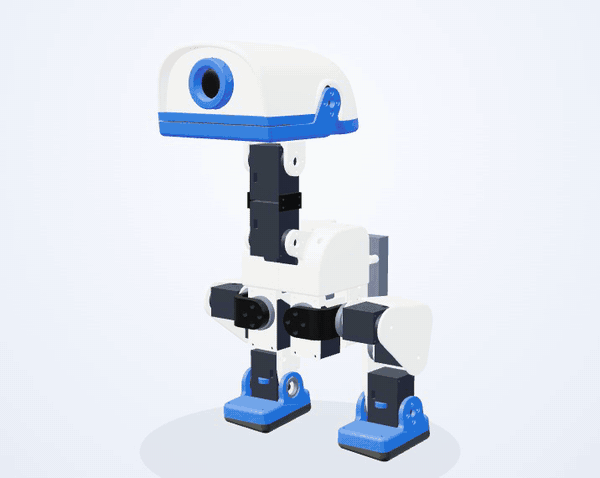
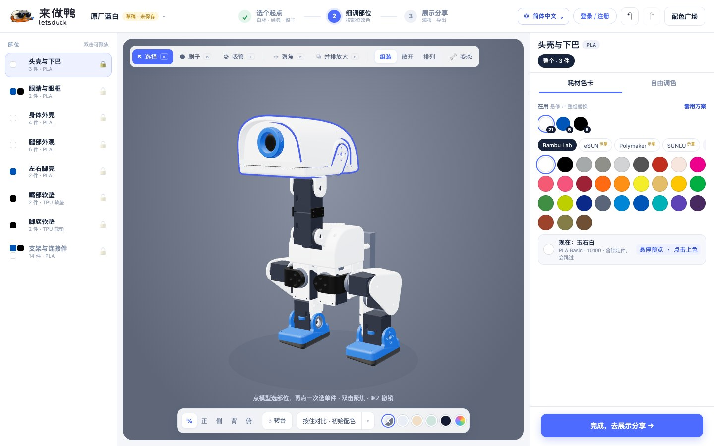
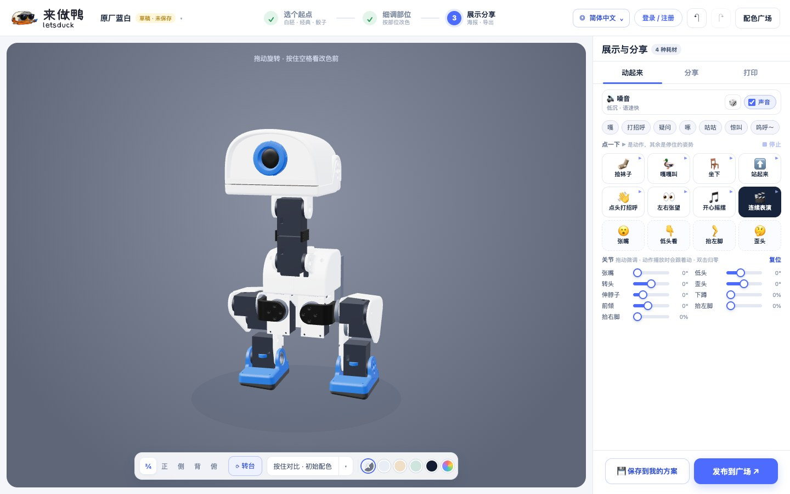
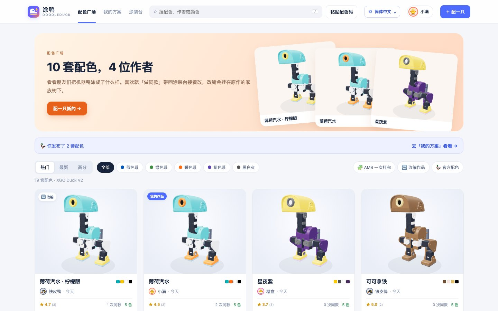

<p align="right"><b>简体中文</b> · <a href="README.en.md">English</a></p>

# 来做鸭 / letsduck

<p align="center"></p>

为 XGO Duck V2 准备的涂装、舵机调试和 3D 组装工具。给机器鸭选颜色，导出改色 3MF 和物料清单；在本机连接 UNO Q，核查舵机编号与参数，再跟着教程组装。

**公开主线提供软件源码。运行需要另行准备有权使用的本地资产包，单独一份 3MF 不够。** 模型、制造数据、教程媒体及其衍生资产有独立授权，代码的 MIT 许可证不覆盖它们。先读 [本地资产说明](docs/local-assets.md) 和 [第三方声明](THIRD_PARTY_NOTICES.md)。

<p align="center"></p>

## 三个入口

个人版首页可以左右拖动三只鸭，也可以用方向键切换。点侧面的鸭子先转到中间，再点中间的鸭子进入功能。

| 入口 | 可以做什么 | 使用条件 |
| --- | --- | --- |
| 来涂鸭 `/paint` | 选配色、细调零件、摆姿势、制作海报、保存方案、导出 3MF + BOM | 完整涂装资产包 |
| 调试鸭 `/debug/` | 查看连接与实时反馈，扫描、核查和修改舵机编号与参数，微调和零位校准 | 本机 USB 连接 UNO Q；已安装 ADB 和兼容的 Duck Runtime |
| 组装鸭 `/assemble/` | 按章节查看材料、取件盘位、3D 安装步骤及参考视频 | 组装资产包；首页入口在 15 个安装编号读回验证通过后解锁 |

涂装台里的动作是屏幕预览。调试鸭中的设备操作会作用于实物，需点击对应操作按钮。打开调试界面只读取状态。

### 涂装与导出

1. **选个起点**：白胚、经典配色、灵感骰子，或自己的已存方案。
2. **细调部位**：点模型或列表选零件，再选耗材颜色或自由调色。支持刷子、吸管、聚焦、A/B 对比和部位锁定。
3. **展示与导出**：摆姿势、播放动作和叫声、换背景、生成海报，导出保留原打印结构的改色 3MF 和 BOM。

<table><tr>
<td></td>
<td></td>
</tr></table>

导出面向固定版本的 35 个零件、6 块打印板。显示姿势和散开效果不写回制造网格。它不提供任意 3MF 导入、自动切片或打印机控制。屏幕颜色不能保证实物色差，模型预览也不能证明装配公差。

手机涂装支持底部步骤面板、双指缩放、双击聚焦和长按对比。涂装与社区提供 12 种语言词典，新增调试和组装界面仍有中文内容；见 [翻译维护](docs/i18n.md)。

### 舵机准备与组装

- 按[厂商指引](https://www.xgorobot.com/duck.html#software)完成 Arduino App Lab、Duck OS 与板卡设置。程序复用已安装的 ADB；非标准路径可通过 `DUCK_ADB` 指定。
- 首次编号时只连接一只舵机。目标编号为 `10–14`、`20–24`、`30–34`。程序匹配运行端配置档，写入后读回复核；同号舵机需分开接入，不能分别寻址。
- 换接前使用安全停机，等待至少 15 秒并确认停止，再断开 USB 和电池。不要带电换接。
- 编号验证记录与当前在线状态分别保存。断线保留记录，改号或未确认的写入会重新计算完成状态；在线数量不代表编号已验证数量。
- 组装教程提供按数量陈列的材料、单件放大旋转、主副舵盘点选和取件记录。取件盘按三排五列固定摆放，取走后留空，不补位。
- 编号、参数与机械零位是不同的事。软件不能修复装反或卡住的机构。线材规格及部分安装朝向仍需结合厂商资料和实物核对，页面完成状态不等于实物验收。

## 选择运行方式

| | 个人使用版 | 服务器版 |
| --- | --- | --- |
| 用途 | 一人在本机涂装、调试和组装 | 朋友间分享配色、评分和改编 |
| 启动 | Node.js 24.20+（24.x） | Docker Compose：nginx + Node.js + MySQL 8.4 |
| 数据 | 本机 SQLite；草稿与偏好在浏览器 | MySQL；浏览器保存未登录草稿 |
| 账号与配色广场 | 无 | 昵称账号、私有方案、发布、评分、「做同款」和改编家族 |
| USB 设备控制 | 本机支持 | 不提供 |

个人版、服务器版与 Electron 桌面端共用 TypeScript 前端、配色校验、存储和 3MF 导出包。以下介绍源码个人版与 Docker 服务器版；桌面候选和随附 Node 的浏览器包见[桌面与离线打包](apps/desktop/README.md)。安装、更新、签名和设备验收分别进行。

## 本机启动

```sh
git clone https://github.com/1850VV/letsduck.git
cd letsduck
npm ci
npm run import:assets -- /path/to/authorized/assets
npm run import:assembly -- /path/to/authorized/assembly/assets
npm run start:local
```

源码开发需要 Node.js 24.20 或更新的 24.x 版本。组装资产导入可以暂时跳过，组装和首页模型预览需要它们；文件要求见 [本地资产说明](docs/local-assets.md)。

也可以双击 `启动来做鸭.command`（macOS）或 `启动来做鸭.bat`（Windows）。先安装上述 Node 版本并运行 `npm ci`。macOS 首次打开如被拦截，可在 Finder 中右键文件并选择「打开」。

浏览器默认打开 `http://127.0.0.1:8876/`，端口被占用时尝试下一个。`npm run start:local -- --port 8880 --no-open` 可指定端口并关闭自动打开浏览器。关闭启动进程即退出。

个人版只监听本机。命名方案、编号验证和取件进度保存在应用目录外的数据库：

- macOS：`~/Library/Application Support/DoodleDuck/personal.db`
- Windows：`%APPDATA%\DoodleDuck\personal.db`
- Linux：`~/.local/share/doodleduck/personal.db`

可用 `DUCK_PERSONAL_DB` 指定数据库位置。更新源码前备份该文件；浏览器草稿与偏好需另行保留。

## 服务器部署

先准备有权使用的涂装资产包，再配置数据库密码：

```sh
npm run import:assets -- /path/to/authorized/assets
cp .env.example .env
# 编辑 .env，设置两个不同的随机长密码
docker compose up -d --build
```

默认地址为 `http://<服务器地址>:8080/`。nginx 提供前端并转发 `/api/`；后端和 MySQL 留在容器内部网络。资产只读挂载，源 3MF 不通过静态地址提供。

配色广场支持热门、最新和高分排序、筛选、评分、「做同款」及改编家族。截图中的账号、作品和评分均为示例数据。



对外部署时，按 [部署说明](docs/deployment.md) 配置 HTTPS、域名和备份。仓库提供可选的 Caddy 配置。`DUCK_PUBLIC_URL` 必须是可公开访问的 HTTPS 域名，分享链接与海报二维码才会生成。`.env` 里的 `DUCK_BIND`、`DUCK_PORT`、数据库与导出并发设置见 [.env.example](.env.example)。

服务器 API 使用 `apps/server` 和共享 TypeScript 包。直接运行时可选 `--static` 提供前端：

```sh
npm ci
npm run start:server -- --host 127.0.0.1 --port 8880 --static frontend/dist
```

服务器端口被占用时直接报错。`DUCK_DATABASE_URL` 或 `DUCK_DB_ENGINE` 配置数据库；账号、私有方案、广场和评分使用同一个 `ServerStore`。导出预检复用纯 `Planner`，生成 3MF 使用有界 worker 队列。服务器不会创建设备服务。

后端与前端构建均使用 Node 24，前端运行镜像使用 nginx。升级、只读源库迁移和回退见 [部署说明](docs/deployment.md)。

## 开发与验证

应用源码、前端、工具和常规测试统一使用严格 TypeScript。`frontend/` 经 Vite 构建到 `frontend/dist/`，个人版和服务器都服务构建产物。保留 `/paint`、`/assemble/`、`/debug/`、`/gallery/` 与各自版本的入口规则；服务器的 `/` 是涂装台，个人版的 `/` 是三入口首页。

工作区职责：`packages/contracts` 提供 schema 与类型；`domain` 提供浏览器/Node 共用规则和精确 JSON；`exporter` 提供 3MF、BOM、预检和有界 worker；`storage` 提供个人 SQLite 与服务器 SQLite/MySQL；`devices` 提供共享总线上的异步设备控制；`host` 用 Cordis 组合 Fastify、存储和服务生命周期。`apps/local`、`apps/server`、`apps/desktop` 是各自入口。桌面窗口只管理本机协议、下载、更新与进程，共用业务代码。

```sh
npm ci
npm run build
npm run typecheck
npm test
npm run probe:runtime
npm run audit:typescript
npm run audit:publication
```

`typecheck` 检查前端、全部测试、工具和构建配置，禁止用 JS 绕过严格检查。`audit:typescript` 检查活跃自有代码的语言、类型抑制及固定 vendor 指纹；厂商 JS 与 `tools/history/` 的归档工具有明确保留用途。`audit:publication` 检查跟踪文件中的私有路径、资产、凭据与生成物。扫描是启发式检查，不能代替人工核查。

`npm test` 使用临时数据库和假设备，包含桌面单元测试。缺少独立授权资产时，会逐文件列出未执行的资产测试；几何包测试也会明确跳过。完整迁移源码检查使用已有合法资产运行 `npm run verify:phase7`，桌面真实运行与安装专项见[打包说明](apps/desktop/README.md)；不能把资产缺失的源代码 CI 当作完整产品验收。MySQL 测试需要专用 `duck_test_*` 库的 `DUCK_TEST_DATABASE_URL`，未配置时明确跳过；测试按序运行。

浏览器检查使用 Playwright 托管 Chromium。安装匹配版本后，设置 `DUCK_TEST_BROWSER=1` 可运行浏览器生命周期专项；需 nginx 的协议检查在没有本机 nginx 时明确跳过。原生控件、人工视觉、真实设备与安装包验收分别报告。

个人版开发可使用 `npm run start:local -- --port 0 --no-open`，并显式给 `DUCK_PERSONAL_DB` 指定开发库。源码启动器会先构建。服务保留 `--host`、`--port`、`--no-open`，停止后排空自有请求、导出线程和服务，不把开发操作指向已有用户数据库。

数据库迁移：`npm run migrate:database -- SOURCE.db --backup COPY.db`。它只读源库并建立一致性备份；目标必须为空，或仍是未经修改的同一快照。该命令会写入所配置的目标，使用前核对 `DUCK_DATABASE_URL` / `DUCK_DB_ENGINE` / `DUCK_DB`。普通测试不会迁移个人或生产库。

行为与性能采集默认使用独立 Node 个人服务与临时数据库：

```sh
npm run baseline:capture -- --assets /path/to/authorized/assets --output output/baseline --browser
```

默认采集 30 次保存和 10 次真实导出，保留环境、引擎、请求/响应和 ZIP 摘要。结果含本机环境和独立授权资产信息，只放在忽略的私有目录。缺少模型的结果不能作为真实导出证据。性能比较必须使用相同输入、机器和环境。

macOS同机新旧对照使用独立的显式测试入口，自动先构建当前前端与共享宿主：

```sh
npm run baseline:compare -- --revision FULL_OLD_COMMIT --python /path/to/legacy/python --assets /path/to/authorized/assets --output output/comparison
```

它交替运行两个隔离引擎，使用同一个静态来源、相同前端字节和空库副本。默认三轮、每轮30次保存与10次导出；模型完整绘制、真实输入后的交互帧和帧间隔分别记录。浏览器冷上下文不等于清空系统文件缓存；小样本尾延迟与资源差异须按报告范围解释。该入口需要旧提交可读及明确选择的Python，仅用于历史对照，不是普通运行依赖；不要与其他GUI、导出或构建同时测量。

`--pilot`只跑一轮试跑，写入`pilot.json`并标明采样预算未完成，不能作为正式验收。测量使用有窗口的managed Chromium与默认GPU，资源采样需要POSIX `ps`；设备路由在对照中隔离，扫描/停止及实机性能须单独验收。

每次运行须使用新的空输出目录，工具拒绝复用非空目录并保留旧证据。交互时间戳要求该次可信移动的业务响应及完整模型帧；宿主启动单独统计并纳入暂停清单。采样完成与性能通过分别报告，须检查`threshold`、`pauseItems`和`timingPause`，不能只看命令成功退出。

常规构建、测试与工具不需要 Python。独立旧 Python 结果已冻结为合成 oracle。显式历史回放可用 `npm run test:historical -- --list` 查看范围，再以 `--python /path/to/legacy/python` 选择解释器；它从固定旧 Git 提交提取只读参考，所有数据和服务都在自有临时目录中。`baseline:capture -- --engine historical ...` 单独采集旧引擎，结果明确标注。浅克隆须先取得参考提交，历史模式不作为正常运行依赖。

组装姿态的跨平台诊断可显式运行 `npx tsx tooling/test/assembly-diagnostic.ts .`。它用 Node 比较固定历史 MJS 与当前 TS 的完整姿态、顺序和数值，并清理临时参考；不需要 Python，也不进入普通测试。

设备测试与模拟界面不能证明实物在线、接线、编号或校准正确。浏览器检查必须使用独立假运行端和临时数据库；完整语言、布局、导出与真实入口验收见相应测试脚本和 [翻译维护](docs/i18n.md)。

## 源码与文档

```text
frontend/   首页、涂装台、调试鸭、组装教程、配色广场与共享模块
apps/       个人版与服务器启动入口
packages/   共用类型、规则、存储、设备、导出与 HTTP 服务
apps/server/ Node 服务器入口（账号、广场、导出）
deploy/     可选 HTTPS 配置
scripts/    本地资产导入、显示模型打包与公开发行检查
tests/      TypeScript Node 与浏览器检查
assets/     另行准备的本地资产；不应提交
```

- [项目结构与边界](docs/project.md)
- [本地资产与复现条件](docs/local-assets.md)
- [部署、迁移与备份](docs/deployment.md)
- [第三方来源与许可证](THIRD_PARTY_NOTICES.md)
- [公开发行范围](docs/publication.md)
- [贡献指南](CONTRIBUTING.md) · [安全报告](SECURITY.md)

## 许可证

原创代码和文档采用 [MIT](LICENSE)。Three.js、meshoptimizer、MicroDuck 等第三方代码保留各自声明，详见 [第三方声明](THIRD_PARTY_NOTICES.md)。模型、制造商数据、品牌及 README 中的模型画面不因本仓库获得新的授权。来做鸭不是 Luwu Dynamics、Pollen Robotics、Bambu Lab 或 DeepSeek 的官方产品。
