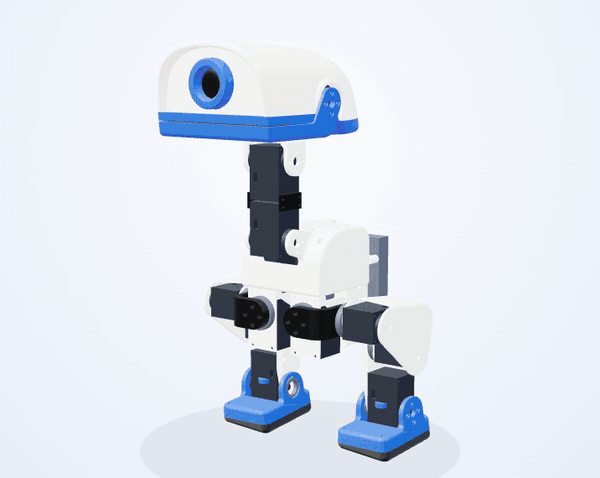
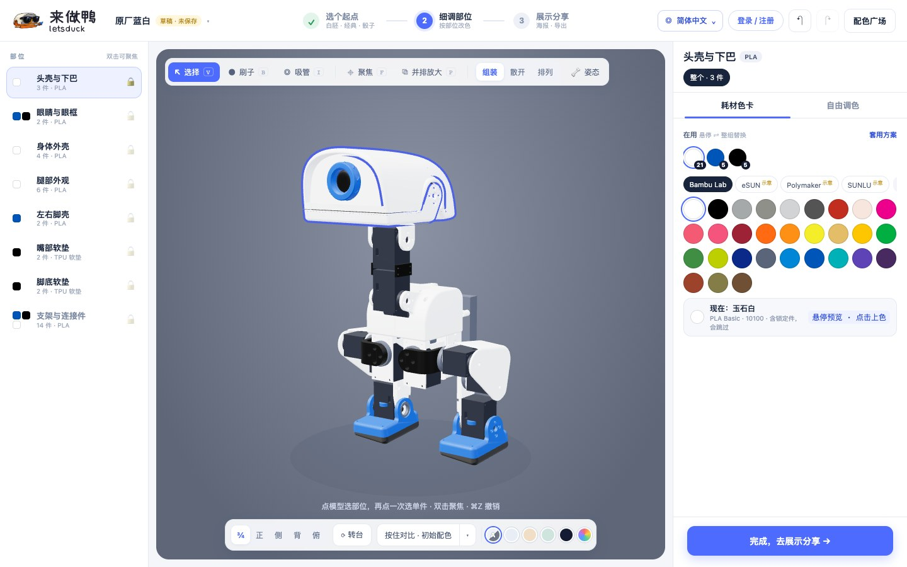
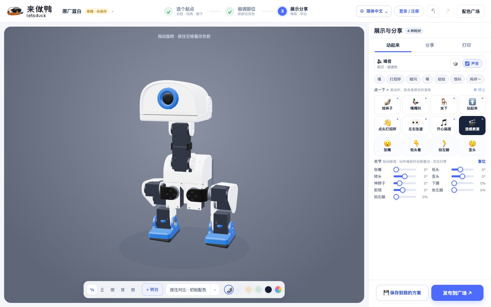

<p align="right"><b>简体中文</b> · <a href="README.en.md">English</a></p>

# 来做鸭 / letsduck

<p align="center"></p>

为 XGO Duck V2 准备的涂装工具。给机器鸭选颜色，制作海报，导出改色 3MF 和物料清单。

> [!IMPORTANT]
> **调试鸭和组装鸭目前均为内测版本，功能尚不可用，仅供预览。**
> **请勿参考组装鸭的教程，也不要使用调试鸭调试真实设备。** 实际调试推荐使用[厂商官方调试程序（下载页）](https://downloads.xgorobot.com/xgoduck/)。

**在本机浏览器里使用：仓库已包含运行所需的模型和资源，双击启动器即可，无需另外准备资产包或 3MF。**

<p align="center"></p>

## 当前维护范围

- **只维护本机浏览器版**（Apple 芯片 Mac）：本机服务加浏览器页面，用于涂装、保存方案、导出，以及调试鸭、仿真鸭。不再提供桌面安装包，也不维护 Windows、Intel Mac 和 Linux。
- **服务器版暂停维护**：暂不开发、适配、更新或部署服务器版。历史源码与说明保留，后续更新不承诺同步适配服务器版；恢复维护需另行明确决定。

## 本机版

首页可以左右拖动三只鸭，也可以用方向键切换。点侧面的鸭子先转到中间，再点中间的鸭子进入功能。

| 入口 | 功能与当前状态 | 使用说明 |
| --- | --- | --- |
| 来涂鸭 `/paint` | 选配色、细调零件、摆姿势、制作海报、保存方案、导出 3MF + BOM | 所需资源已在仓库中 |
| 调试鸭 `/debug/` | 内测版本，功能尚不可用，仅供预览 | 请勿用于真实设备调试；实际调试请使用厂商官方程序 |
| 组装鸭 `/assemble/` | 内测版本，功能尚不可用，仅供预览 | 请勿参考其中的组装教程 |

涂装台中的姿势与动作仅用于屏幕展示，不控制实物。

### 涂装与导出

1. **选个起点**：白胚、经典配色、灵感骰子，或自己的已存方案。
2. **细调部位**：点模型或列表选零件，再选耗材颜色或自由调色。支持刷子、吸管、聚焦、A/B 对比和部位锁定。
3. **展示与导出**：摆姿势、播放动作和叫声、换背景、生成海报，导出保留原打印结构的改色 3MF 和 BOM。

<table><tr>
<td></td>
<td></td>
</tr></table>

导出面向固定版本的 35 个零件、6 块打印板。显示姿势和散开效果不写回制造网格。它不提供任意 3MF 导入、自动切片或打印机控制。屏幕颜色不能保证实物色差，模型预览也不能证明装配公差。

首页、涂装、调试和组装的自有界面使用既有 12 种语言词典；覆盖范围和审校状态见 [翻译维护](docs/i18n.md)。

### 安装与启动

需要 Node.js 24.20+（24.x）。仓库的 `assets/` 已包含所需资源，资源目录说明见[项目资源](docs/local-assets.md)。

```sh
git clone https://github.com/1850VV/letsduck.git
cd letsduck
npm ci
npm run start:local
```

之后双击 `启动来做鸭.command` 即可：它构建页面、启动本机服务并打开浏览器。默认地址为 `http://127.0.0.1:8876/`；端口被占用时尝试下一个。开发时可用 `npm run start:local -- --port 8880 --no-open` 指定端口并关闭自动打开浏览器。更新：`git pull` 后重新双击启动器。

命名方案、编号验证和取件进度保存在 `~/Library/Application Support/DoodleDuck/personal.db`，可用 `DUCK_PERSONAL_DB` 指定位置。草稿、语言、舵机质检结果等偏好保存在浏览器里。

## 服务器版（暂停维护）

服务器版原有账号、私有方案、配色广场、评分与改编功能及 Docker Compose 配置保留。服务器专用功能与部署现已暂停维护；本机版需要的共用前端、存储和导出代码继续维护。现有回归检查通过不代表服务器版获得持续支持。原部署、HTTPS、迁移与备份步骤仅作为[历史参考](docs/deployment.md)。

## 开发与文档

```sh
npm run verify
node --import tsx tests/browser/ui-system.ts
```

完整测试所需的资产、MySQL 与浏览器条件，见[开发与验证](docs/development.md)。技术检查不代替人工交互与实物验收。

- [项目结构](docs/project.md) · [本地资产](docs/local-assets.md) · [翻译维护](docs/i18n.md)
- [贡献指南](CONTRIBUTING.md) · [安全报告](SECURITY.md) · [公开发行范围](docs/publication.md)

## 许可证

原创代码和文档采用 [MIT](LICENSE)。Three.js、meshoptimizer、MicroDuck 等第三方代码保留各自声明，详见 [第三方声明](THIRD_PARTY_NOTICES.md)。模型、制造商数据、品牌及 README 中的模型画面不因本仓库获得新的授权。来做鸭不是 Luwu Dynamics、Pollen Robotics、Bambu Lab 或 DeepSeek 的官方产品。
